# Phase 2 — audit and upgrade plan

Date: 2026-10-14 · Status: **accepted 2026-10-15**, with the recommendation
on every question in §6. Implementation follows §7.

This is the stage-0 deliverable of the phase-2 brief. It has five parts: what
the system does today, with evidence; a backlog grouped A–E; the ADRs that
backlog needs; the places where a goal gives way to a rule; and the decisions
that are the owner's to make. Screenshots are in
[`2026-10-14-phase-2-upgrade/`](2026-10-14-phase-2-upgrade/).

Effort: **S** ≤ half a day · **M** 1–2 days · **L** 3 days or more.
Priority: **P0** do first · **P1** this phase · **P2** if time allows · **P3** later.

---

## 0. One thing before the plan: the local collector is not running

ADR-0022 moved the 17 `reach: cn` series to `scripts/local-collector`, a
launchd job on this machine. That job is not installed. There is no
`~/.hogcycle-collector`, no `~/Library/Logs/hogcycle-collect.log`, and
`launchctl list` shows no `com.hogcycle.collect`. Origin's last two data
commits (2026-10-13 and 2026-10-14, both from `hogcycle-bot`) touch only the
ten `anywhere` series.

So nobody has collected 能繁母猪存栏, any 农业农村部 series, or 玄田's daily
corn and 外三元 since 2026-10-12. The watchdog will not notice until a limit
trips: daily series at 21 days (about 2026-11-02), weekly at 30, monthly at
100, and `sow_inventory` at 150. No data has been lost yet. 玄田's daily
tables keep about a year, and the ministry pages stay up. But this is exactly
the single point of failure the brief asks about in D, and it is already
happening.

Installing the job pushes to origin every day, so I have not done it. It is
decision **Q1** below. Item D1, a heartbeat, would have flagged this within a
day.

---

## 1. Corrections to the brief

Five premises in the brief do not match the repository. Each one changes the
plan.

| The brief says | What is there | Consequence |
|---|---|---|
| The contract has `published_on` on readings only, not on points | Every point already carries `p` when the source dates it (ADR-0017), and `panels[].revisions` carries every print with `p` and `learned` | Time travel needs one more fact per point: the day the warehouse first learned an *undated* value. That costs about 2 KB today (§2.4), not a reshaped contract |
| `export --as-of` rebuilds the past | It cuts on `fetched_at`, the audit view. `hogcycle export --as-of 2024-03-15` prints `no data in silver — run hogcycle collect first`, because every row was fetched on or after 2026-09-05 | The backtest view (`published()`) has no CLI or page yet. The error message also points the wrong way |
| 海关 monthly imports and 统计局 quarterly 出栏/产量 are new sources to find | Both are already in the 五部委 monthly workbook, in bronze, for every edition since 2021-12 | They are config entries plus `hogcycle replay`, with zero HTTP. So is 豆粕, from the weekly 500县 report (§2.5) |
| `silver` compaction, if done carefully, is logically a no-op | ADR-0009 makes the parquet files *the record*, and "a day with no change costs 0 bytes, diffable as new files" is why. Compaction deletes record files from the tree | It is a deviation from an ADR, not an optimisation. At today's size it buys nothing (§2.7) |
| Turn the ADR-0018 玄田 vs ministry check into a repeatable check | 玄田's piglet and carcass tables are retired or replaced. The pairs that still overlap are different ones | The cross-source checks are listed in E1 |

---

## 2. Audit

### 2.1 What was run

```
backend   pytest -q                 122 passed in 1.78s
          ruff check .              clean
status    hogcycle status           all live except hog_corn_ratio
                                    (dark 56d, acknowledged until 2026-12-31)
          --fail-on-stale           exit 0
export    hogcycle export           28 panels, 7,618 points, 336.7 KB, 28 CSVs
frontend  npm run build             Next 16.3.4 / Turbopack, 64 static pages, ok
browser   out/ served locally       overview, wall, compare, series ·
                                    zh + en · light + dark · 1280px + 390px
```

The generated `wall.json` and `next-env.d.ts` were restored after the build.
The working tree is as it was. Local `main` is two data commits behind
`origin/main`.

**Screenshot coverage.** Every page type, both languages, both themes and both
widths appear in at least one screenshot. Not all 32 combinations were taken.
The browser window would not resize, so phone width was rendered in 390px
same-origin iframes. Media queries respond to the iframe width, so the layout
is the real phone layout.

### 2.2 The pages as they stand

| | |
|---|---|
| 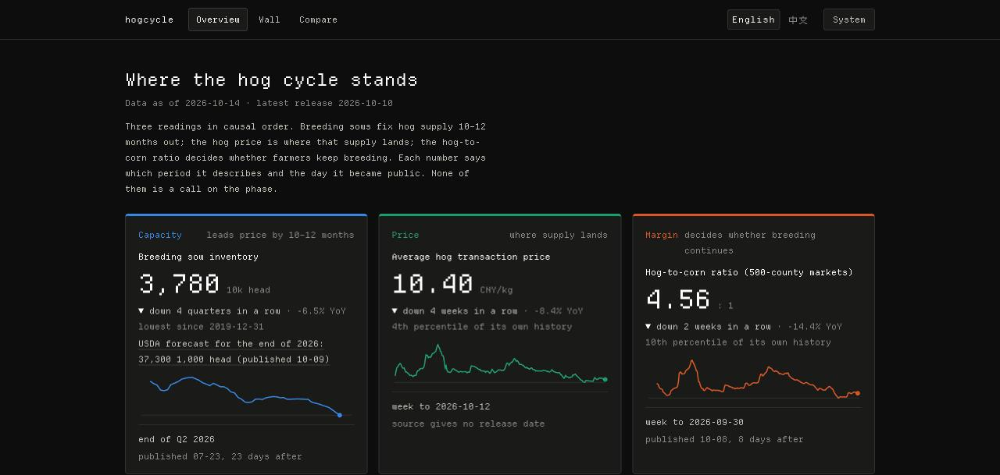 | **Overview, first screen (en, dark).** It answers the page's question: three cards in causal order, each saying its period and release lag. A new reader gets the gist in 30 seconds. They do not learn what 正常保有量 or "500-county markets" mean. |
| 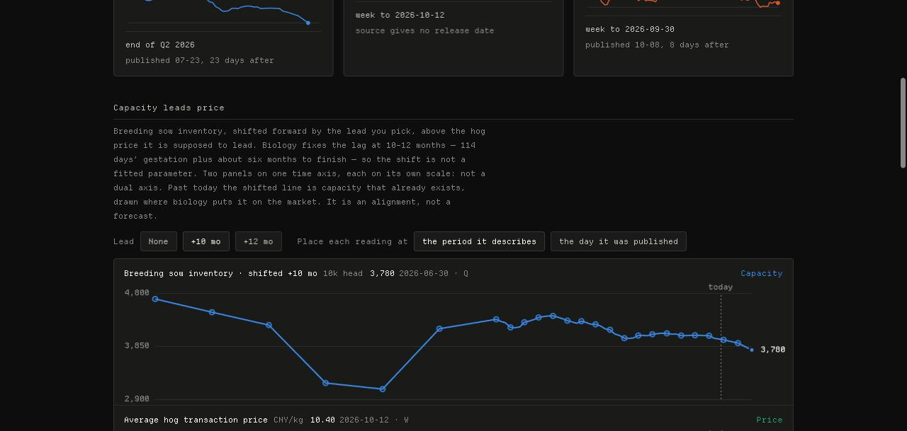 | **Thesis chart.** Annual points from 2015 to 2020 are joined by straight 12-month segments, which reads as a path the data never measured. |
| 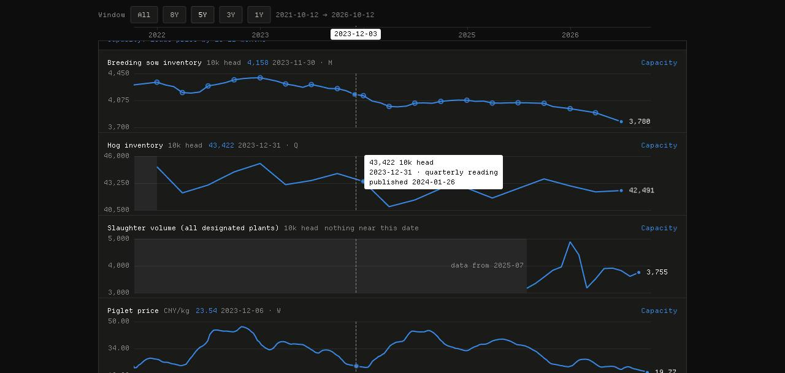 | **Wall, crosshair by time.** It works: every header reads its own value at 2023-12-03, and 屠宰量 says "nothing near this date". `hog_inventory` is quarterly-only and draws **no** hollow markers, which contradicts the page's own "hollow points are quarterly" line. |
| 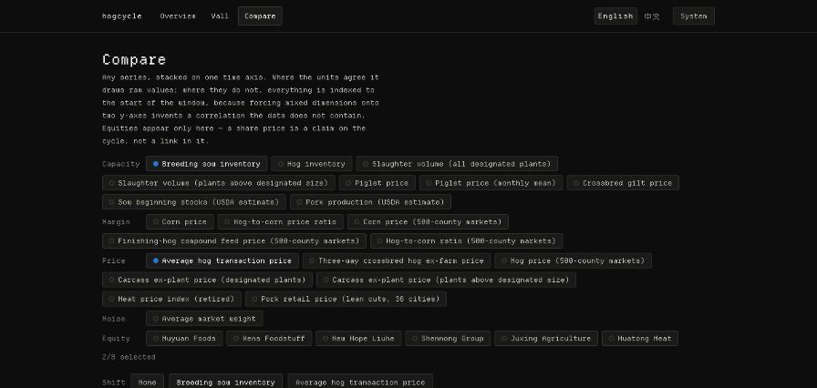 | **Compare.** There are 28 chips before the chart. On a phone the chart starts about 1,000px down. |
| 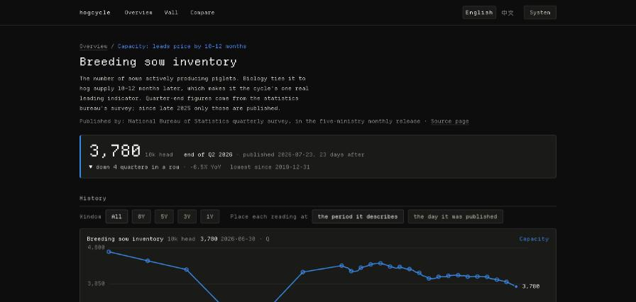 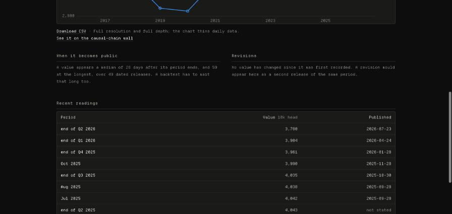 | **Series page.** It has release lag and revisions. There is no way to ask what was knowable on a given day. |
| 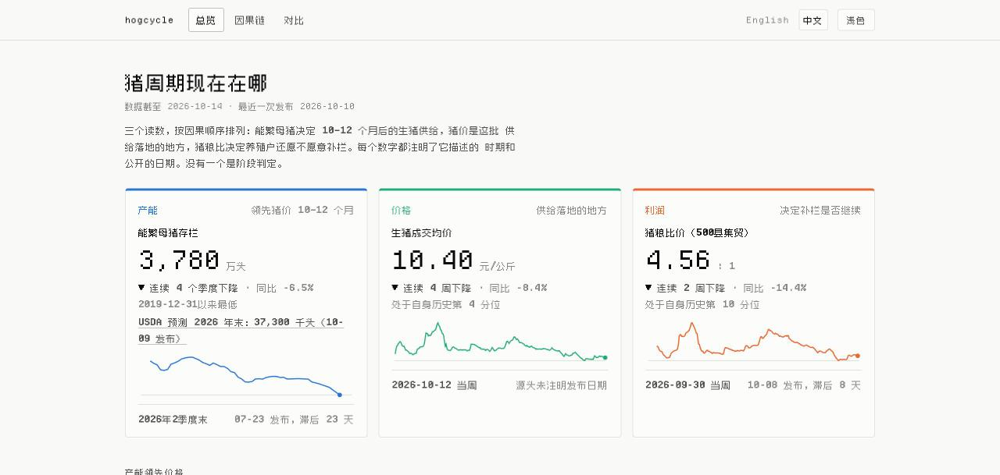 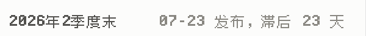 | **zh, light.** In the zoomed footer, 「季度末」 and 「发布，滞后」 are visibly softer than 「年」. They are zpix drawn off its 12px grid. |
| 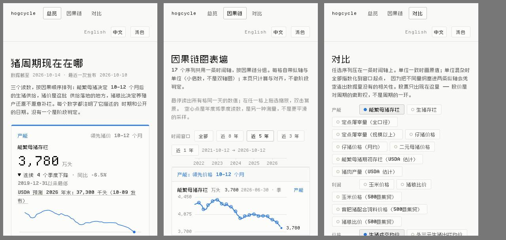 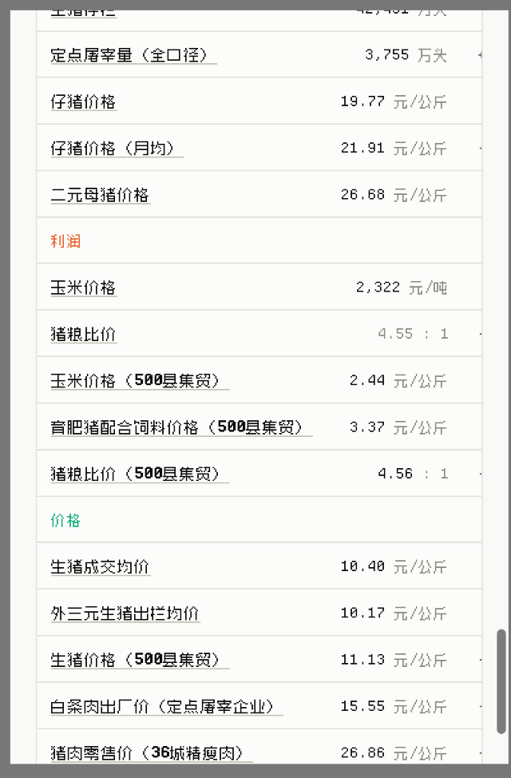 | **Phone, zh.** There is no page-level horizontal scroll, which is good. The nav takes two rows. The readings table is 742px inside a 348px box, so YoY, position, as-of and the `STALE` tag are off-screen with no hint. |
| 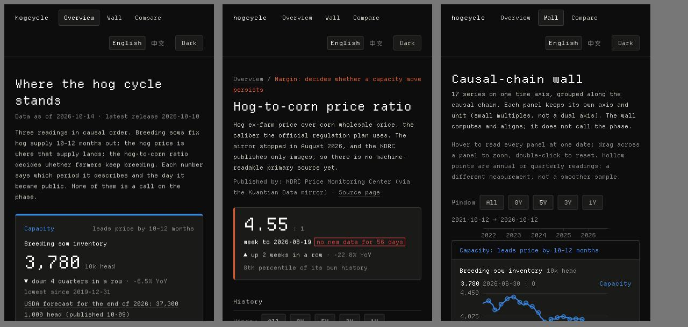 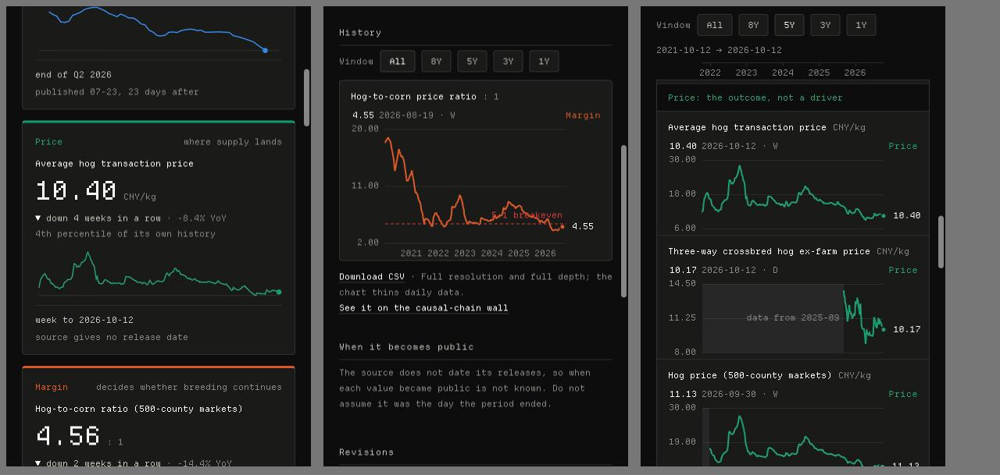 | **Phone, en, dark, stale series.** Stale is stated in text before anything else, which is right. The tag's red is 3.6:1 on the card. |

### 2.3 UI findings (evidence for B)

1. **The CJK pixel grid is broken on the Chinese page.** I walked the text
   nodes of `/zh/` and found 210 runs containing Han characters. **108** of
   them render off zpix's 12px grid: 105 at 11px (section headings, buttons,
   table headers, units, `.muted` notes, the language toggle) and 3 in
   synthesised bold (`<b>` at 700). CLAUDE.md requires prose to read
   `var(--type)`, and `.num` is for numerals only. The cause is that `.num`
   and the hard-coded `11px` on `button`, `th`, `.section` and `.muted` were
   written for the English grid. Font *coverage* is fine: one character in
   the built HTML (`’`) is missing from the subset, none in Chinese.
2. **Contrast, WCAG AA (4.5:1 for text).** Computed from the tokens in
   `globals.css`:

   | token as text | light, on page / surface | dark, on page / surface |
   |---|---|---|
   | `--muted` | **3.41 / 3.50** | 5.41 / 4.85 |
   | `--capacity` | **4.19 / 4.30** | 5.34 / 4.79 |
   | `--margin` | **3.04 / 3.12** | 5.00 / **4.48** |
   | `--price` | **2.67 / 2.74** | 5.71 / 5.11 |
   | `--critical` (STALE) | 4.56 / 4.68 | 4.05 / **3.62** |

   `--muted` carries most secondary text, including "source gives no release
   date". The tier hues are used as *text* in card headers, wall group
   headings and table group rows. Their palette was validated as marks, not as
   type.
3. **Phone.** The readings table hides the status column (finding above). The
   nav takes about 100px in two rows. The compare picker comes before the
   chart. The only `@media` rule in the CSS is `prefers-color-scheme`. The
   layout reflows through flex-wrap alone, which works but cannot reorder.
4. **Theme flash (from code, not observed).** `ThemeToggle` sets `data-theme`
   in `useEffect`, after hydration. A stored light or dark choice therefore
   paints in the system theme first, on every load, and every language switch
   is a full load (ADR-0014).
5. **Keyboard and assistive tech (from code).** I could not get synthetic Tab
   presses to reach the page, so this comes from reading the code. Panels are
   `role="img"` with a name, unit and count, and are not focusable. The
   crosshair is pointer-only. `:focus-visible` is styled in the nav only;
   buttons and chips fall back to the browser ring. `TableView` covers the
   wall, month-end resampled, with no `<caption>` and no row headers. The
   thesis chart and compare have no table twin. The series page shows 12 rows
   plus the CSV.
6. **Weight.** HTML is overview 105 KB (18.6 KB gz), wall 266 KB (43 KB gz)
   and compare 422 KB (64 KB gz). The wall and compare load about 1,064 KB of
   decoded JS (≈350 KB gz), and the overview shares the same ECharts chunk for
   its thesis chart. That chunk alone is 592 KB (197 KB gz), and it is
   tree-shaken correctly: no unregistered chart types are in it. Local loads
   finish in under 200ms. **I did not measure under throttling**, so "first
   screen on a slow phone" is an estimate (≈2s on Fast 3G for the JS), not a
   measurement.
7. **Positions compare unlike histories.** "24th percentile" for
   外三元生猪出栏均价 is over about one year of data. "4th" for
   生猪成交均价 is over 11.7 years. The table does not say which.
8. **Stale, empty and error states.** Stale is handled well, in text, on
   cards, the series page and the table. There is no state for "the next
   release is late but the series is not stale yet", which is D5. A static
   site has no error state.

### 2.4 Data intuition and interaction (evidence for A)

- **The 2024-03-15 question is answerable from silver today, not from the
  page.** `SilverStore.published("sow_inventory", by=2024-03-15)` gives
  **2024年1月, 4,067 万头, published 2024-02-26**. The quarter-end
  2023-12-31 figure (4,142) came out earlier, on 2024-01-26.
- **What time travel costs in the contract.** Of 7,618 points, 5,924 carry no
  `p`. Every undated point needs the day the warehouse first learned it. With
  a per-panel default (2026-09-06 for all of them) and an override only where
  it differs, that is **112 overrides, about 2 KB**. It grows by roughly one
  override per day per forward-collected daily series. The encoding (an
  absolute date or a day offset from `d`) is ADR-0023's to decide.
- **What time travel shows for 2024-03-15.** Every series with release dates
  appears: sow, hog inventory, the 500县 weekly prices, 屠宰量, retail,
  piglet, gilt. Series with **no** release dates (行情宝 生猪成交均价, 玄田
  corn and 外三元, 出栏均重, equities) were first learned on 2026-09-06, so
  they are absent for any date before that. They are shown as "release date
  not stated by source; first learned 2026-09-06", never placed by an assumed
  lag. The overview's price card has nothing for 行情宝 on that date. That is
  the rule working, not a bug (§4).
- **Caliber and granularity boundaries are not in the contract.**
  `caliber_from` / `caliber_until` live in `sources.yaml` only. The wall
  shades "data from 2025-07" at a series' first point, which is coverage, not
  a caliber break. The granularity switches in `sow_inventory` (annual through
  2020, monthly plus quarter-end from 2021-12, quarter-end only after 2025-10)
  are visible only as marker shapes.
- **Status disagrees with the wall about calibers.** `hogcycle status` counts
  raw silver, so `carcass_price` reads n=451 from 2018-01-07, although its
  `caliber_from` is 2024-01-01 and the wall draws 144 points.

### 2.5 Sources (evidence for C)

Hosts were probed once each from this machine (a residential connection
outside China) for robots.txt and reachability. "Runner" reach is unknown
until a `workflow_dispatch` probe runs.

| candidate | publisher, where | cadence · caliber · depth | release date given? | reach (here) | robots / terms | same measurement as something held? | verdict |
|---|---|---|---|---|---|---|---|
| 进口猪肉, 进口猪杂碎 (and 出口) | 海关总署, inside the 五部委 monthly XLSX (`www.moa.gov.cn/ztzl/szcpxx/jdsj/`) | monthly, 万吨, 2021-12– (51 editions in bronze). **January appears only inside 「1-2月」**, a caliber trap to resolve before plotting | yes, the workbook stamp (ADR-0017) | `cn`, same as `moa` | as `moa` today | no, new | **P1, config + replay, zero HTTP** |
| 生猪出栏, 猪肉产量 | 统计局, same workbook | **year-to-date only**: 1季度 / 上半年 / 前3季度 / 全年. 15 editions | yes | `cn` | as above | no, new | **P1** as YTD indicators. A single-quarter flow is a gold difference and needs its own ADR line |
| 规模/散养 生猪每头 产值·成本·净利润 | 发改委 cost survey, same workbook | monthly, 元/头, 2021-12 – **2025-08, then absent** | yes | `cn` | as above | no. It is the margin layer's only direct profit measure | **P1**, after checking whether the series stopped upstream (`retired`, closed) or moved |
| 全国生猪出场价格 | 发改委, same workbook | monthly, 元/公斤, 2021-12– | yes | `cn` | as above | a **fifth** hog-price caliber, so its own panel | P2 |
| 白条猪批发价 (全国批发市场 / 36城批发) | same workbook | monthly, two calibers | yes | `cn` | as above | two new calibers | P2 |
| 县乡集贸市场猪肉零售价格 | same workbook | monthly | yes | `cn` | as above | new caliber | P3 |
| **全国豆粕平均价格** | 畜牧兽医局 weekly 500县 report (`xmsyj.moa.gov.cn/jcyj/`) | weekly, 元/公斤, 2021-12– | yes, `PubDate` meta | `cn` | as `moa_weekly` | no. It completes feed cost in **one survey on one collection day** with 生猪 and 玉米 | **P1, config + replay** |
| 全国猪肉平均价格 (500县) | same report | weekly | yes | `cn` | as above | new caliber | P2 |
| 生猪收购价 (定点屠宰) | weekly slaughter report | weekly | yes | `cn` | as above | new caliber. Scope must be matched as for carcass (ADR-0018) | P2 |
| 发改委 猪粮比价 | 价格监测中心 on 中国价格信息网 | weekly, image only (ADR-0018) | — | `chinaprice.com.cn` did not answer | — | the threshold caliber | No machine-readable primary. At `review_by` 2026-12-31, retire per ADR-0018. **Never** auto-retire |
| 大商所 生猪期货 LH | `www.dce.com.cn` | daily settlement and OI per contract, 2021-01– | the trade date is the date | **no answer in 20s** | not read (no response) | a market price, not a measurement. Needs its own tier | P3. Needs a runner probe, a tier ADR, and a decision on how a contract month is stored. A sina "continuous" contract is a mirror that splices calibers at every roll, so it is not a primary source |
| 上市猪企月度销售简报 | 巨潮资讯 `cninfo.com.cn` | monthly per company, PDF | yes, the announcement time | **200** | no robots.txt (404) | company-level 出栏 and 均价, new | P2. Needs a PDF parser (new dependency) and a tier decision |
| CPI 猪肉分项 | 统计局 | monthly, YoY % in prose only | yes, the article date | `data.stats.gov.cn` redirects (WAF, ADR-0013) | — | new | P3 |
| 海关 direct | `stats.customs.gov.cn` | — | — | **412 anti-bot challenge** | — | covered by row 1 | **not collected.** Defeating a challenge is off the table |

### 2.6 Autonomy (evidence for D)

- The single point of failure exists, and today it has failed outright (§0).
  The only detector is staleness, which takes 21–150 days.
- `with_retry` retries **every** fetch failure three times with backoff,
  including 403s, so a blocked host costs three slow attempts and is reported
  as `upstream failed after 3 attempts: <exc>`. Parse and validation errors
  happen outside the retry, so they already fail on the first attempt, which
  is right.
- No payload-shape check runs before `normalise`. A renamed column surfaces as
  a parse error, which is loud (good) but does not name the drift as drift.
- `upstream_dark` lapses silently until the day after `review_by`.
  `hog_corn_ratio` lapses on 2026-12-31, and nothing reminds anyone before
  then.
- `release_lag` (median, max) is computed and exported, but nothing turns it
  into "the next release is overdue".

### 2.7 Data engineering (evidence for E)

| check | today |
|---|---|
| uniqueness (indicator, obs_date, published_on, fetched_at) | 0 duplicates in 19,464 rows. Enforced nowhere except by `append_changes`' logic |
| value range | `lo`/`hi` per spec, batch aborts. Good |
| volume | none |
| cross-source | none automated. ADR-0015 and 0018 comparisons were one-off |
| run metadata | none persistent. The bronze manifest records fetches that succeeded. Failures leave no trace outside the workflow log |
| silver files | 228 files, 1.1 MB. Full scan 67ms. Each `query()` opens a new DuckDB connection and re-globs, which costs more than the file count does (`export` takes 5.2s) |
| contract check | `export/contract.py::_check` is hand-rolled: required keys and point order. No types, enums or `additionalProperties`. No version. CI never runs `export` (deploy does) |
| gold | 5 modules, 1 derived series. Most of the logic (streaks, extremes, thinning) is Python, not SQL |
| property tests | none, and `hypothesis` is not a dependency |
| near the 500-line ceiling | `en.tsx` 398, `theme.ts` 380, `silver.py` 356, `moa.py` 354, `PanelChart.tsx` 337, `moa_weekly.py` 335 |
| tooling | `next-env.d.ts` flips between `.next/dev/types` and `.next/types` on every dev/build, so it shows up as a diff |

---

## 3. Backlog

### A. Data intuition and interaction (highest priority)

| id | item | rules / ADRs touched | effort | prio |
|---|---|---|---|---|
| A1 | **As-of time travel.** A date control on the overview, wall and series pages, kept in the URL. A point is shown if `p ≤ date`, or, when it has no `p`, if first-learned `≤ date`, and each of the two is labelled. A revised period shows the print in force on that date (from `revisions`). Undated series hidden by the cut are listed with why. The series page answers the 2024-03-15 question in one line. The contract gains a per-panel `learned` default plus per-point overrides, and a version bump | ADR-0001, 0007, 0017. A release date is read, never assumed. Gold computes (see A1b) | L | P1 |
| A1b | Computed facts (streak, extreme, percentile) **in as-of mode**: hide them, or precompute | gold computes, never judges; ADR-0016 "page renders numbers, not works them out" | — | **Q3** |
| A1c | CLI: `hogcycle export --as-of` keeps its audit meaning. Fix its error message ("nothing was learned by 2024-03-15; the warehouse began 2026-09-05") and add `hogcycle published --indicator X --by DATE` | — | S | P1 |
| A2 | **Publication lag on the wall and compare.** A "place at publication date" switch (it exists on the thesis and series pages). The hover readout adds "published +28d" | ADR-0016, 0017 | M | P1 |
| A3 | Revised points get a ring marker on the wall and compare, linked to the series page's trail. One revision exists today; USDA's April release will add more | ADR-0020 | S | P2 |
| A4 | **Caliber and granularity breaks drawn on the chart.** A labelled mark at `caliber_from` / `caliber_until`, and where `g` changes (sow: annual → monthly at 2021-12, monthly → quarter-end only after 2025-10). The contract carries the bounds on the panel | ADR-0008, 0018. Never mix calibers on one line | M | P1 |
| A5 | **Coarse readings always marked.** Hollow markers whenever `g ∈ {Q, A}`, not only in mixed series. Segments that span more than one period are dashed, so a line between annual points does not read as a measured path | ADR-0008. No interpolation passed off as data | S | P1 |
| A6 | Series search / command palette (⌘K or /). Both names and the id, and it jumps to the series page or adds to compare | i18n copy in both languages | M | P2 |
| A7 | **Keyboard reading of a panel.** Panels become focusable. ←/→ steps observations and moves the synced crosshair. The readout is announced through `aria-live` | — | M | P1 |
| A8 | **Range statistics.** Shift-drag (zoom stays plain drag) selects a span and shows first and last value, % change, min and max with dates, and the end's percentile in the span. Facts only | Computed in the browser over a reader-chosen range → **Q4** | M | P2 |
| A9 | **Cycle overlay by reader-chosen anchors.** The reader clicks a date per cycle; each cycle is re-based to t=0 and indexed to 100. Anchors live in the URL. There is no algorithmic turning-point detection, ever | Same as A8; the no-phase-calling rule | L | P3 |

### B. UI, look and friendliness

| id | item | rules / ADRs | effort | prio |
|---|---|---|---|---|
| B1 | **Put every CJK run on the 12px grid.** Anything that can hold Chinese takes `var(--type)`, `.num` only wraps numerals, and `<b>` emphasis becomes ink colour at weight 400. A test walks the built `/zh/` HTML and fails on off-grid Han text | CLAUDE.md two-grid rule, ADR-0014 | S–M | **P0** |
| B2 | **AA contrast.** Darken light `--muted` to ≥4.5:1. Tier text uses an `--<tier>-ink` variant, or ink with a swatch. Raise dark `--critical`. Re-run the palette validator on the marks | ADR-0012 palette; no red/green for direction (unchanged) | M | **P0** |
| B3 | **Phone layout.** One-row nav. The readings table becomes stacked rows with status visible. The compare picker folds behind search (A6) | — | M | P1 |
| B4 | Theme set before first paint (a small inline script in each root layout's `<head>`) | ADR-0014 | S | P1 |
| B5 | **Terms explained in place**: 能繁母猪, 正常保有量 (and that it moved 4100→3900→3750, with dates), 口径, 猪粮比价 5:1, release date vs period, hollow markers. A disclosure next to the term, with copy in `i18n/` in both languages and the font subset re-cut | i18n rule, subset rule. Moving baseline: no ratio against today's | M | P1 |
| B6 | Positions say their depth: "4th pct · 11.7y" vs "24th pct · 1.1y" | Nothing invented on a card (ADR-0019). The span is contract data | S | P1 |
| B7 | Weight: slice the contract per page (ADR-0016/0018 already call it due), and lazy-load ECharts below the fold on the overview. Measure with Lighthouse under throttling first | ADR-0006, 0007 | M | P2 |
| B8 | Designed `:focus-visible` for every control. `<caption>` and row headers in `TableView` | — | S | P1 |
| B9 | Table twins for compare and the full series history | — | M | P2 |
| B10 | Stop the `next-env.d.ts` churn | — | S | P3 |

The design language (pixel faces, tokenised colour) stays. Nothing in this
list needs an ADR to replace it.

### C. More sources

| id | item | rules / ADRs | effort | prio |
|---|---|---|---|---|
| C1 | **From the monthly workbook already in bronze**: 进口猪肉, 进口猪杂碎, 出口; 生猪出栏 and 猪肉产量 (YTD); 规模/散养 每头成本·净利润. Each one: `extract` entry, real fixture cut from bronze, `about.yaml` in both languages, lo/hi, `max_age_days`, `reach: cn`, caliber bounds, `hogcycle replay`. Resolve the 「1-2月」 imports trap and the post-2025-08 cost gap first | Primary source; caliber split; fixture rule; a release date is read | M | P1 |
| C2 | **From the weekly report already in bronze**: 全国豆粕平均价格 (completes 500县 margin inputs), then 全国猪肉平均价格 and 生猪收购价 | same | S | P1 / P2 |
| C3 | 全国生猪出场价格, 白条猪批发价 ×2, 县乡零售 (workbook) | same | S each | P2 / P3 |
| C4 | 上市猪企月度销售简报 (cninfo): runner reach probe, PDF parser, tier decision | new dependency; tier ADR | L | P2 |
| C5 | 大商所 LH: runner reach probe first. No mirror without a week-by-week check against DCE | Mirror rule; new tier; contract month as an attribute | L | P3 |
| C6 | 发改委 猪粮比价: report at `review_by`, no automatic action | ADR-0015, 0018 | — | (Q2 date) |

### D. System autonomy

| id | item | rules / ADRs | effort | prio |
|---|---|---|---|---|
| D1 | **Run log and heartbeat.** Every `collect` appends one record per run to `data/runs/<reach>/<yyyy-mm>.jsonl` (committed, append-only): host kind, reach, start and end, and per indicator the status, rows, duration, error class and bronze snapshot id. GitHub's watchdog fails if the newest `cn` record is older than about 36 hours, and the stale-series issue names it | ADR-0002 (append-only), 0022 | M | **P0** |
| D2 | **Failure classes.** `transient` (timeout, reset, 5xx) is retried with backoff. `blocked` (403/412/451, WAF bodies) gets no retry and is reported as "this host refuses this network; see `reach`". `structure` (shape, parse, validation) gets no retry and fails loudly. The class goes into the run log | "Collect a source from where it answers" | S–M | P1 |
| D3 | **Schema drift before parse.** Each adapter declares a shape fingerprint: akshare column set, workbook 指标 names, weekly 「…为」 names. It is compared with the previous bronze snapshot before `normalise`, and the failure message names what appeared or vanished. A new 指标 in the workbook is information; a configured one vanishing is an error | "Errors name what they saw" | M | P1 |
| D4 | `upstream_dark` early warning: status prints "lapses in N days", and the issue comments at 14 and 3 days out | ADR-0015. Never auto-renew, never auto-retire | S | P1 |
| D5 | **Release calendar.** From each series' own (period end → `published_on`) history, compute "next release usually by" (p90 lag). A late release shows as *overdue*, separate from stale, on the page and in status. It is **computed only, and never written to `published_on`** | A release date is read, never assumed | M | P2 |

### E. Data-engineering practice

| id | item | rules / ADRs | effort | prio |
|---|---|---|---|---|
| E1 | **Quality checks** as one module: uniqueness on the bitemporal key (runtime and test), volume against the trailing median per indicator (warn), and cross-source agreement. The cross-source pairs are: piglet weekly→monthly mean vs `piglet_price_monthly` (ADR-0015: 43/55 exact, 53/55 within 1%), 发改委 vs 500县 猪粮比价 (ADR-0018: r=0.996, mean gap 0.26), 统计局 vs USDA year-end sows (equal from 2023), and gilt price 玄田 vs ministry. Results go into the run log and status | ADR-0015, 0018, 0021 | M | P1 |
| E2 | **Observability.** The run log (D1) is queryable through DuckDB. `hogcycle status` shows the last run and last success per series. The contract gains a small `health` block (last collection per reach) that the page can show | ADR-0007 contract change | M | P1 |
| E3 | Silver reads reuse one connection per command. **No compaction** (Q5) | ADR-0009 | S | P2 |
| E4 | dbt: recommend **not** adopting, and closing ADR-0010 as rejected (Q6) | ADR-0010 | S (ADR) | P2 |
| E5 | **Contract version and real validation.** `contract_version` in the schema and payload. Validation uses a real JSON Schema engine in tests and in CI. CI runs `export` against committed silver and validates. The frontend build checks the major version | ADR-0007 | S–M | P1 |
| E6 | **Property tests** (`hypothesis`, dev only) over random collection histories with revisions, re-releases and undated→dated prints. (1) `as_of(t)` is unchanged by any append with `fetched_at > t`. (2) `published(by, moment=m)` is unchanged by appends after `m`. (3) Replaying the same batch writes nothing | ADR-0001, 0017 | M | P1 |
| E7 | Split files before they pass 500 lines, when touched: `silver.py` → reads and writes; `en.tsx`/`zh.tsx` → per-page dictionaries, still typed `Dict = typeof en`; `theme.ts` → option builders | 500-line ceiling | S each | as touched |
| E8 | `status` and `coverage()` honour caliber bounds | ADR-0018 | S | P2 |

---

## 4. Where a goal gives way to a rule

These are already decided by CLAUDE.md. They are listed so nobody is surprised
by them later.

- **Time travel hides undated series rather than guess.** For any date before
  2026-09-06, 行情宝, 玄田 daily, 出栏均重 and equities do not appear in the
  as-of view. Showing them would mean assuming `published_on = obs_date`.
- **No phase call, even interactively.** The cycle overlay (A9) aligns on
  anchors the *reader* picks. Nothing detects a turning point.
- **`hog_corn_ratio` is not retired automatically** when its acknowledgement
  lapses. D4 reminds; a person decides.
- **No 大商所 data through a mirror** without a week-by-week check against
  DCE itself, which this machine cannot reach.
- **No 海关 direct collection** (412 challenge). The same numbers arrive
  through the joint release.
- **No dual axis, no red/green** in any new chart: A8 statistics, A9 overlay
  and the D5 overdue state.
- **The release calendar never writes `published_on`.**

---

## 5. ADRs to write (from 0023)

| # | title (working) | backs |
|---|---|---|
| 0023 | Time travel on a static site: the contract carries when each value was knowable | A1, A1b, A4 |
| 0024 | The contract is versioned and validated against its schema in CI | E5 |
| 0025 | Every run leaves a record; the local collector's absence is a failure within a day | D1, E2 |
| 0026 | Failures are classified; a payload that changes shape fails before it is parsed | D2, D3 |
| 0027 | Quality checks: what fails a run, what warns, and which sources must agree | E1 |
| 0028 | More of the joint release: imports, output, cost and profit, as new calibers | C1–C3 (including the YTD and 「1-2月」 rulings) |
| 0029 | The release calendar: an expectation, never a date | D5 |
| 0030 | Silver is not compacted (or the opposite, if Q5 goes the other way) | E3 |
| 0031 | dbt is not adopted; ADR-0010 closes (or the opposite, per Q6) | E4 |
| later | A market tier for futures; company sales reports | C4, C5 |

---

## 6. Decisions that are the owner's

| | question | my recommendation |
|---|---|---|
| **Q1** | Install the local collector here (`scripts/local-collector/install.sh`), run it somewhere else, or accept the gap until D1 exists? It pushes to origin daily | Install it now. D1 then makes its absence loud |
| **Q2** | 猪粮比价 at 2026-12-31: retire it as ADR-0018 says, or renew? | Decide at the date. D4 will ask on 12-17 |
| **Q3** | Facts in as-of mode: hide them, or precompute them at export? | **Hide**, and state why on the page. Precomputing every day is a second wall per day |
| **Q4** | May the browser compute facts over a range or anchors the *reader* chose (A8, A9)? ADR-0016 says the page renders, not computes | **Yes, only for reader-chosen inputs**, with each number labelled "computed in your browser from the points shown". Gold cannot precompute a range nobody has picked yet |
| **Q5** | Compact silver? | **No.** It deviates from ADR-0009's record and diff story, and at 228 files and 67ms it buys nothing. Revisit at about 10k files or a 1s scan |
| **Q6** | dbt? | **No.** Close ADR-0010 as rejected. One SQL model does not earn a second toolchain, and the rest of gold is Python |
| **Q7** | Futures and company reports: in this phase or later, and under which tier? | Company reports P2, behind `in_wall: false` like equities. Futures later |
| **Q8** | This spec and its screenshots: commit them as a `docs:` commit? | Yes, once you have read it |

## 7. Proposed order

1. **P0**: Q1 decided; D1 heartbeat; B1 grid; B2 contrast.
2. **The core**: ADR-0023 → contract v2 (E5 first, since it validates the
   change) → A1 → A4/A5 → A2.
3. **Cheap breadth**: ADR-0028 → C2 豆粕 → C1, one series per commit, each
   with a fixture and a replay.
4. **Robustness**: D2, D3, D4, then E1, E6, E2.
5. **Friendliness**: B3–B6, B8, A7.
6. **If time allows**: A3, A6, A8, D5, B7, B9, C3, C4.

Every step ends with `pytest -q && ruff check .`, `hogcycle replay` with silver
diffed before and after, `hogcycle export`, `npm run build`, and, for frontend
changes, screenshots in zh/en × light/dark × desktop/phone.
